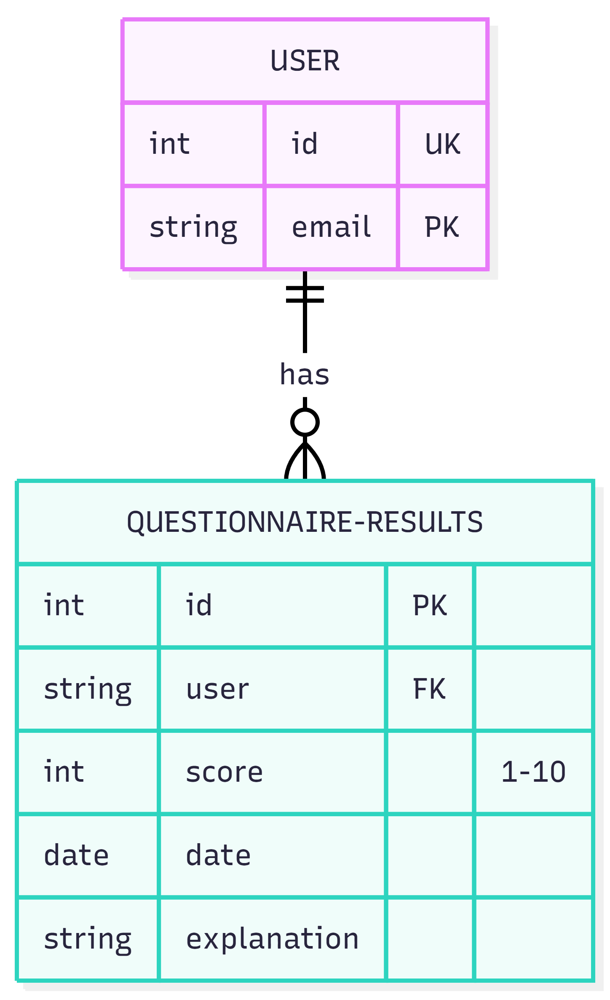

# HvA-meter
De HvanA-website heeft nog geen barometer. In dit project voegen we die toe onder de naam HvA-meter. Daarvoor hebben we de hele homepage nagebouwd, zodat de HvA-meter in de bestaande opzet past.

## Inhoudsopgave

- [Live link](#live-link)
- [Installatie instructies](#installatie-instructies)
- [Beschrijving van de site](#beschrijving-van-de-site)
- [Pagina's](#pagina's)
- [Eindresultaat](#eindresultaat)
- [Ontwerp](#ontwerp)
- [Gebruik van de site](#gebruik-van-de-site)
- [Keuzes en afwegingen](#keuzes-en-afwegingen)
- [Techniek](#techniek)
- [Bronnen](#bronnen)
- [Designkeuzes](#designkeuzes)
- [Datamodel](#datamodel)
- [Toekomstige uitbreidingen](#toekomstige-uitbreidingen)
- [Code conventies](#code-conventies)
- [Contributing](#contributing)

## Live link

[Bekijk de livesite](https://hvana.netlify.app/)

## Installatie instructies

Het project is gemaakt met [SvelteKit](https://svelte.dev/docs/kit).

1. Clone de repository en ga naar de `dev` branch:

```sh
   git clone https://github.com/fdnd-agency/hvanabarometer.git
   cd hvanabarometer
   git checkout dev
```

2. Installeer de dependencies:

```sh
   npm install
```

3. Start de development server:

```sh
   npm run dev

   # of start de server en open de site meteen in een nieuw tabblad
   npm run dev -- --open
```

4. Open de site via de link die in de terminal verschijnt, meestal `http://localhost:5173`.

Een productieversie maken en bekijken:

```sh
npm run build
npm run preview
```

## Beschrijving van de site

### De opdracht

De HvanA-website had meer interactie met studenten nodig. Daarom kregen we van de opdrachtgever de opdracht om een barometer voor de website te maken. Met de barometer kunnen studenten per dag aangeven hoe ze hun dag op de HvA hebben ervaren.

### Onze uitwerking: de HvA-meter

In het begin heette het project gewoon "barometer". Wij hebben de naam veranderd naar HvA-meter, omdat je er elke dag het cijfer van de dag mee meet. De repository heet nog wel `hvanabarometer`.

Om de HvA-meter te laten passen in de bestaande opzet, hebben we de hele homepage van HvanA nagebouwd. Iedereen kan op de site zien wat het gemiddelde cijfer is en hoeveel studenten al hebben gestemd.

### Hoe werkt het

Studenten kiezen een cijfer van 1 tot en met 10 en geven in een kort tekstveld een toelichting. Ze vullen ook hun HvA-e-mailadres in (verplicht), zodat de inzending aan een gebruiker gekoppeld kan worden. Daarna versturen ze hun stem met de knop "Verzend".

### De site bestaat uit

- De nagebouwde homepage van HvanA
- Een HvA-meter-balk met het gemiddelde cijfer, het aantal stemmen en een knop om te stemmen
- De HvA-meter als `<dialog>` met cijferkeuze, toelichting, e-mailadres en een verzendknop
- Een detailpagina met een hero en alle uitslagen
- Een styleguide met kleuren, fonts en spacing

## Pagina's

### Homepage met HvA-meter

De homepage is een nagebouwde versie van de HvanA-homepage, aangevuld met de HvA-meter. In de HvA-meter-balk zie je het gemiddelde cijfer en het aantal stemmen. Met de knop "Stemmen" open je de HvA-meter, een `<dialog>` waarin een student een cijfer van 1 tot en met 10 kiest, een korte toelichting schrijft en het HvA-e-mailadres invult. Met "Verzend" wordt de stem opgeslagen.


### Detailpagina

De detailpagina bereik je door in de HvA-meter-balk op het aantal stemmen te klikken. Bovenaan staat een hero met het gemiddelde cijfer, daaronder zie je alle uitslagen. De hero is een herbruikbare component, net als de header.


## Eindresultaat

Het eindresultaat is een website waarop studenten zelf iets kunnen doen. Met de HvA-meter geven ze in een paar klikken aan hoe ze hun dag op de HvA hebben ervaren, en ze zien meteen wat anderen vonden. Zo is de HvanA-website van een site waar je alleen informatie leest veranderd in een site waar studenten ook interactie hebben.

De onderdelen zijn uiteindelijk één geheel geworden:

- **Homepage met HvA-meter-balk:** de nagebouwde homepage met het gemiddelde cijfer en het aantal stemmen.
- **De HvA-meter (dialog):** een korte dialog waarin een student een cijfer kiest, een toelichting schrijft en het HvA-e-mailadres invult.
- **Detailpagina:** een pagina met een hero en alle uitslagen, bereikbaar via de HvA-meter-balk.
- **Directus:** alle stemmen worden opgeslagen en weer opgehaald, zodat het gemiddelde cijfer en het aantal stemmen altijd actueel zijn.
- **Styleguide en components:** de herbruikbare header, hero en andere onderdelen zorgen dat alle pagina's er hetzelfde uitzien.

De opdrachtgever was tevreden met het resultaat.


## Ontwerp

Het ontwerp staat in [Figma](https://www.figma.com/design/9FWic2H39qxzVw1M8mHraP/HavanA?node-id=17-2&t=ZxF1eIDh1nTqIRmE-0).


## Gebruik van de site

Een cijfer geven:

1. Klik in de blauwe barometer-balk (HvA-meter) op "Stem".
2. Kies een cijfer van 1 tot en met 10.
3. Vul een korte toelichting in.
4. Vul je HvA-e-mailadres in. Dit is verplicht.
5. Klik op "Verzend".
6. Sluit de dialog met "Terug" of met de Esc-toets.

Uitslagen bekijken:

Klik in de barometer-balk (HvA-meter) op het aantal stemmen. Je komt dan op de detailpagina met het gemiddelde cijfer en alle uitslagen.

## Keuzes en afwegingen

- **Korte dialog in plaats van extra velden:** we hebben ook een versie met extra invoervelden uitgewerkt en in code getest. Daarbij werd de popup te lang en te complex voor studenten. We hebben daarom gekozen voor de korte versie met een cijfer, een toelichting en een e-mailadres. Zo is invullen snel en blijft de drempel laag.

Hieronder staat de uitgebreide versie die we niet hebben gekozen:
 


- **De naam "HvA-meter":** het project heette eerst "barometer". We hebben de naam veranderd naar "HvA-meter", omdat je er het cijfer voor de dag mee meet en dit laat zien hoe studenten die dag de HvA hebben ervaren.

## Techniek

- **SvelteKit:** voor de website, de pagina's en de herbruikbare components.
- **Directus:** hier worden de gebruikers en de inzendingen opgeslagen en opgehaald.
- **Netlify:** voor de livesite.

## Bronnen

- [MDN: dialog](https://developer.mozilla.org/en-US/docs/Web/HTML/Reference/Elements/dialog)
- [MDN: fieldset](https://developer.mozilla.org/en-US/docs/Web/HTML/Reference/Elements/fieldset)
- [Formgent: types of forms](https://formgent.com/types-of-forms/)
- [SvelteKit documentatie](https://svelte.dev/docs/kit)
- [HvanA](https://hvana.nl): lettertype en logo komen van de bestaande website


## Designkeuzes

- **Dialog in plaats van pop-up:** we gebruiken het HTML-element `<dialog>`, omdat dat beter is voor de toegankelijkheid. De browser regelt het openen en sluiten, de focus blijft in de dialog en de Esc-toets sluit hem.
- **Styleguide:** kleuren, fonts, spacing en tekstgroottes staan als CSS-variabelen in de styleguide, zodat de hele site hetzelfde oogt.
- **Components:** de site is opgebouwd uit kleine, herbruikbare Svelte-components.
- **Kleur en font:** blauw is de primaire kleur. Koppen gebruiken het U8-font van HvanA en lopende tekst gebruikt Georgia.
- **Ontwerp:** gebaseerd op de Figma-ontwerpen.


## Datamodel

Het datamodel laat zien welke gegevens we opslaan en hoe ze aan elkaar gekoppeld zijn. Het bestaat uit twee tabellen:

- `hvana_barometer_users`: de gebruiker, met het HvA-e-mailadres en `last_login`.
- `hvana_barometer_responses`: de inzending, met het cijfer, de toelichting en `submitted_at`. De foreign key `user_id` koppelt elke inzending aan een gebruiker.

De tabellen staan in Directus. Het model is aangepast na feedback van een docent (zie issue #31).



## Toekomstige uitbreidingen

- Een tabel `barometer_forms`, zodat er voor meerdere onderwerpen een barometer ingevuld kan worden.
- Extra tabellen om de vragen per formulier aan te passen.

Dit bespreken we met de opdrachtgever voor de feature wishlist.

## Code conventies

We commiten altijd met een prefix, zoals `feat:`, `fix:`, `style:` of `refactor:`.

Voorbeeld: `feat: add barometer hero component`

Onze code conventies staan in de [CONTRIBUTING.MD](https://github.com/fdnd-agency/hvanabarometer/blob/dev/CONTRIBUTING.MD).

## Contributing

Voor de werkwijze en alle regels, zie [CONTRIBUTING.MD](https://github.com/fdnd-agency/hvanabarometer/blob/dev/CONTRIBUTING.MD).
