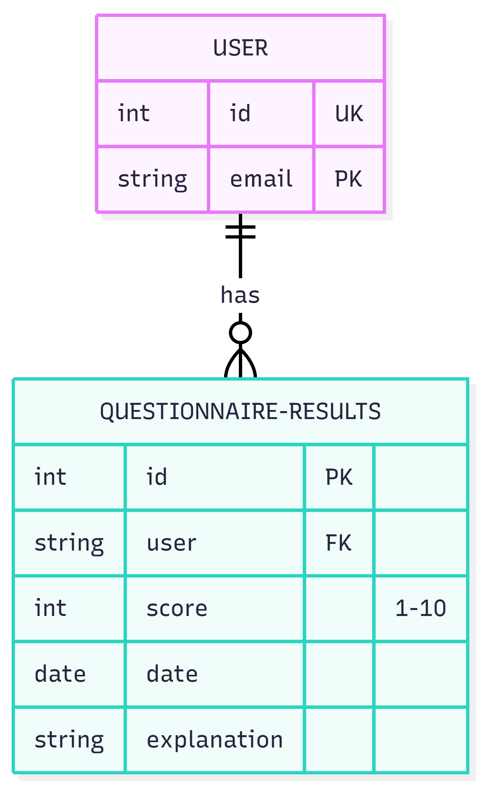

# HvA-meter
De HvanA-website heeft nog geen barometer. In dit project voegen we die toe onder de naam HvA-meter. Daarvoor hebben we de homepage van HvanA nagebouwd en een detailpagina met alle uitslagen gemaakt.

## Inhoudsopgave

- [Live link](#live-link)
- [Installatie instructies](#installatie-instructies)
- [Beschrijving van de site](#beschrijving-van-de-site)
- [Mockups van de site](#mockups-van-de-site)
- [Gebruik van de site](#gebruik-van-de-site)
- [Bronnen](#bronnen)
- [Designkeuzes](#designkeuzes)
- [Datamodel](#datamodel)
- [Kenmerken van de site (code)](#kenmerken-van-de-site-code)
- [Link naar code conventies](#link-naar-code-conventies)
- [Link naar CONTRIBUTING.MD](#link-naar-contributingmd)

## Live link

[Bekijk de livesite](https://hvana.netlify.app/)

## Installatie instructies

Het project is gemaakt met [SvelteKit](https://svelte.dev/docs/kit).

1. Clone de repository en ga naar de `dev` branch:

   ```sh
   git clone https://github.com/fdnd-agency/hvanabarometer.git
   cd hvanabarometer
   git checkout dev
   ```

2. Installeer de dependencies:

   ```sh
   npm install
   ```

3. Start de development server:

   ```sh
   npm run dev

   # of start de server en open de site meteen in een nieuw tabblad
   npm run dev -- --open
   ```

4. Open de site via de link die in de terminal verschijnt, meestal `http://localhost:5173`.

Een productieversie maken en bekijken:

```sh
npm run build
npm run preview
```

## Beschrijving van de site

De HvanA-website had meer interactie met studenten nodig. Daarom kregen we van de opdrachtgever de opdracht om een barometer te maken. Hiermee geven studenten per dag aan hoe ze hun dag op de HvA hebben ervaren. Wij noemen de barometer de HvA-meter, omdat je er elke dag het cijfer van de dag mee meet. De repository heet nog wel `hvanabarometer`.

De site bestaat uit twee pagina's.

### 1. Homepage met HvA-meter (`/`)

De homepage is een nagebouwde versie van de HvanA-homepage, aangevuld met de HvA-meter.

- **HvA-meter-balk:** een blauwe balk onder de header met het gemiddelde cijfer, het aantal stemmen en een knop om te stemmen.
- **HvA-meter (dialog):** een `<dialog>` waarin een student een cijfer van 1 tot en met 10 kiest, een korte toelichting schrijft en het HvA-e-mailadres invult.
- **Artikelen:** de nagebouwde artikelen en rubrieken van HvanA (nieuws, opinie, video en podcast).

### 2. Detailpagina met uitslagen (`/meter-uitslag`)

De detailpagina bereik je door in de HvA-meter-balk op het aantal stemmen te klikken.

- **Hero:** bovenaan het gemiddelde cijfer en het aantal reacties.
- **Uitslagen:** daaronder een kaart per stem met het cijfer, de toelichting en de datum. De nieuwste stem staat bovenaan.

## Mockups van de site

Het ontwerp staat in [Figma](https://www.figma.com/design/9FWic2H39qxzVw1M8mHraP/HavanA?node-id=17-2&t=ZxF1eIDh1nTqIRmE-0).

### Homepage met HvA-meter-balk


### HvA-meter (dialog)


### Detailpagina met uitslagen


## Gebruik van de site

### Een cijfer geven (homepage)

1. Klik in de blauwe HvA-meter-balk op "Stem ➔".
2. Kies een cijfer van 1 tot en met 10.
3. Vul een korte toelichting in (maximaal 500 tekens).
4. Vul je HvA-e-mailadres in. Dit is verplicht en moet eindigen op `@hva.nl`.
5. Klik op "Verzend". De knop laat zien of het versturen gelukt is.
6. Sluit de dialog met "Sluiten" of met de Esc-toets.

### Uitslagen bekijken (detailpagina)

1. Klik in de HvA-meter-balk op het aantal stemmen.
2. Je komt op de detailpagina met het gemiddelde cijfer en alle uitslagen.

## Bronnen

- [MDN: dialog](https://developer.mozilla.org/en-US/docs/Web/HTML/Reference/Elements/dialog)
- [MDN: fieldset](https://developer.mozilla.org/en-US/docs/Web/HTML/Reference/Elements/fieldset)
- [Formgent: types of forms](https://formgent.com/types-of-forms/)
- [SvelteKit documentatie](https://svelte.dev/docs/kit)
- [Directus documentatie](https://directus.io/docs)
- [HvanA](https://hvana.nl): lettertype en logo komen van de bestaande website

## Designkeuzes

- **Dialog in plaats van pop-up:** we gebruiken het HTML-element `<dialog>`, omdat dat beter is voor de toegankelijkheid. De browser regelt het openen en sluiten, de focus blijft in de dialog en de Esc-toets sluit hem.
- **Korte dialog in plaats van extra velden:** we hebben ook een versie met extra invoervelden uitgewerkt en in code getest. Daarbij werd de dialog te lang en te ingewikkeld voor studenten. We kozen voor de korte versie met een cijfer, een toelichting en een e-mailadres, zodat de drempel laag blijft.

  

- **Kleur en font:** blauw is de primaire kleur. Koppen gebruiken het U8-font van HvanA en lopende tekst gebruikt Georgia.
- **Styleguide:** kleuren, fonts, spacing en tekstgroottes staan als CSS-variabelen in de styleguide, zodat beide pagina's hetzelfde ogen.
- **Ontwerp:** gebaseerd op de Figma-ontwerpen.

## Datamodel

Het datamodel laat zien welke gegevens we opslaan en hoe ze aan elkaar gekoppeld zijn. De tabellen staan in Directus:

- `hvana_barometer_users`: de gebruiker, met het HvA-e-mailadres en `last_login`.
- `hvana_barometer_responses`: de inzending, met het cijfer (`score`), de toelichting (`explanation`) en `submitted_at`. De foreign key `user_id` koppelt elke inzending aan een gebruiker.

Het model is aangepast na feedback van een docent (zie issue #31).



## Kenmerken van de site (code)

### Techniek

- **SvelteKit (Svelte 5):** voor de pagina's en de herbruikbare components.
- **Directus:** hier worden de gebruikers en de inzendingen opgeslagen en opgehaald.
- **Netlify:** voor de livesite.

### Projectstructuur

```
src/
├── lib/
│   ├── atomen/      # kleine onderdelen, zoals logo, iconen en links
│   ├── molecules/   # o.a. Header, Baroheader, BarometerPopup, Herodetailpage, ResultaatKaart
│   ├── organisms/   # MeterUitslag (de inhoud van de detailpagina)
│   └── styles/      # styleguide.css met CSS-variabelen
└── routes/
    ├── +page.svelte              # homepage
    ├── +page.server.js           # gemiddelde ophalen + stem opslaan
    └── meter-uitslag/
        ├── +page.svelte          # detailpagina
        └── +page.server.js       # alle uitslagen ophalen + stem opslaan
```

De components zijn opgebouwd volgens atomic design: atomen, molecules en organisms.

### Homepage

- **`load` in [+page.server.js](src/routes/+page.server.js):** haalt alle scores op uit Directus en berekent het gemiddelde (afgerond op 1 decimaal) en het aantal stemmen. Deze gegevens gaan als props naar `Baroheader`.
- **Form action `?/hvameter`:** verwerkt het formulier op de server. De invoer wordt gecontroleerd (cijfer 1 t/m 10, e-mail verplicht en eindigt op `@hva.nl`, toelichting maximaal 500 tekens). Bestaat de gebruiker nog niet, dan wordt die eerst aangemaakt. Daarna wordt de stem opgeslagen en aan de gebruiker gekoppeld.
- **Progressive enhancement:** het formulier werkt zonder JavaScript via een gewone POST. Met JavaScript wordt het formulier met `fetch` verstuurd en laat de knop de status zien: "Verzenden...", "Verzonden ✔" of "Opnieuw proberen".
- **Invoker commands:** de knoppen openen en sluiten de dialog met `commandfor` en `command`, zonder extra JavaScript.

### Detailpagina

- **`load` in [meter-uitslag/+page.server.js](src/routes/meter-uitslag/+page.server.js):** haalt alle inzendingen op, gesorteerd van nieuw naar oud, en berekent het gemiddelde en het aantal reacties.
- **`Herodetailpage`:** toont het gemiddelde in Nederlandse notatie (met komma) via `toLocaleString("nl-NL")`.
- **`ResultaatKaart`:** toont per inzending het cijfer, de toelichting en de datum.

### Foutafhandeling

- Alle fetches staan in een `try/catch`. Is Directus niet bereikbaar, dan krijgt de pagina een fallback (geen gemiddelde, 0 stemmen) in plaats van een foutpagina.
- Gaat het opslaan mis, dan geeft de form action een `fail(500)` terug met een duidelijke foutmelding.
- Bij 1 stem staat er "stem", bij meer stemmen "stemmen".

## Link naar code conventies

We commiten altijd met een prefix, zoals `feat:`, `fix:`, `style:` of `refactor:`.

Voorbeeld: `feat: add barometer hero component`

Al onze code conventies staan in de [CONTRIBUTING.MD](https://github.com/fdnd-agency/hvanabarometer/blob/dev/CONTRIBUTING.MD#codeconventies).

## Link naar CONTRIBUTING.MD

Voor de werkwijze, teamafspraken en alle regels, zie [CONTRIBUTING.MD](https://github.com/fdnd-agency/hvanabarometer/blob/dev/CONTRIBUTING.MD).
